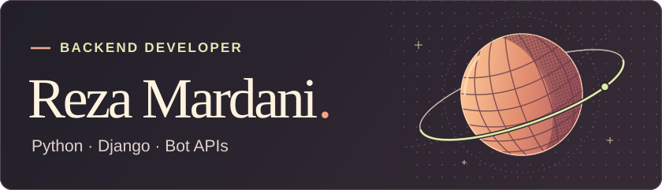
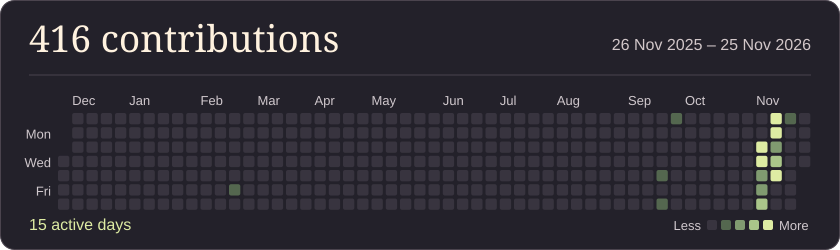

I build bots and backend tools. On Bale, my projects range from a Python library for bot developers to a Persian-language role-playing game you can play in a chat.

  
  

## Selected work

  
  
   
  
  

[Baleropy documentation](https://github.com/rezamardani01/baleropy-docs) ? [Anonymous Chat Bot](https://github.com/rezamardani01/anonymous-chat-bot) ? [iTransit Bot](https://github.com/rezamardani01/iTransit-Bot) ? [All repositories ?](https://github.com/rezamardani01?tab=repositories)

## On GitHub

