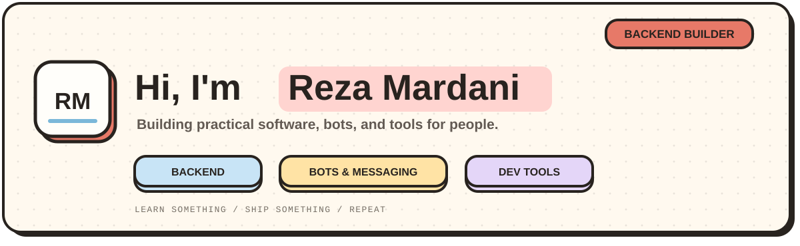
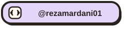
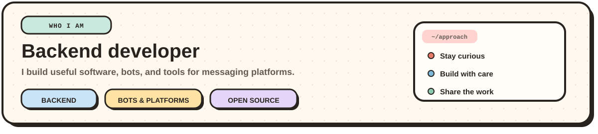
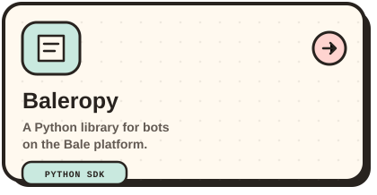
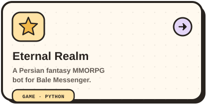
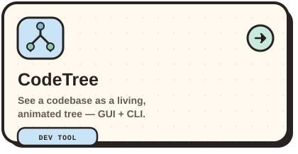
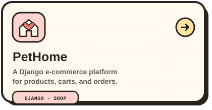

<picture>
  <source media="(prefers-color-scheme: dark)" srcset="./assets/profile-hero.svg" />
  <source media="(prefers-color-scheme: light)" srcset="./assets/profile-hero-light.svg" />
  
</picture>

 

  

 

 

<picture>
  <source media="(prefers-color-scheme: dark)" srcset="https://raw.githubusercontent.com/rezamardani01/rezamardani01/output/github-snake-dark.svg" />
  <source media="(prefers-color-scheme: light)" srcset="https://raw.githubusercontent.com/rezamardani01/rezamardani01/output/github-snake.svg" />
  
</picture>

 

 

<picture>
  <source media="(prefers-color-scheme: dark)" srcset="./assets/whoami.svg" />
  <source media="(prefers-color-scheme: light)" srcset="./assets/whoami-light.svg" />
  
</picture>

 

<table>
<tr>
<td width="25%" align="center">
<a href="https://github.com/rezamardani01/Baleropy">
  <picture>
    <source media="(prefers-color-scheme: dark)" srcset="./assets/project-baleropy.svg" />
    <source media="(prefers-color-scheme: light)" srcset="./assets/project-baleropy-light.svg" />
    
  </picture>
</a>
</td>
<td width="25%" align="center">
<a href="https://github.com/rezamardani01/Eternal-Realm-Game">
  <picture>
    <source media="(prefers-color-scheme: dark)" srcset="./assets/project-eternal-realm.svg" />
    <source media="(prefers-color-scheme: light)" srcset="./assets/project-eternal-realm-light.svg" />
    
  </picture>
</a>
</td>
<td width="25%" align="center">
<a href="https://github.com/rezamardani01/codetree">
  <picture>
    <source media="(prefers-color-scheme: dark)" srcset="./assets/project-codetree.svg" />
    <source media="(prefers-color-scheme: light)" srcset="./assets/project-codetree-light.svg" />
    
  </picture>
</a>
</td>
<td width="25%" align="center">
<a href="https://github.com/rezamardani01/PetHome">
  <picture>
    <source media="(prefers-color-scheme: dark)" srcset="./assets/project-pethome.svg" />
    <source media="(prefers-color-scheme: light)" srcset="./assets/project-pethome-light.svg" />
    
  </picture>
</a>
</td>
</tr>
</table>

**Also on my workbench:** [Baleropy Docs](https://github.com/rezamardani01/baleropy-docs) · [Anonymous Chat Bot](https://github.com/rezamardani01/anonymous-chat-bot) · [iTransit Bot](https://github.com/rezamardani01/iTransit-Bot) · [All repositories](https://github.com/rezamardani01?tab=repositories)

 

Made with curiosity, coffee, and too many open tabs.

