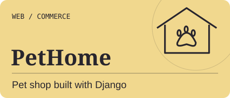

<picture>
  <source media="(max-width: 559px), (min-width: 768px) and (max-width: 849px)" srcset="./assets/orbit-compact.svg">
  
</picture>

I build bots and developer tools in Python. My [Baleropy](https://github.com/rezamardani01/Baleropy) framework powers [Eternal Realm](https://github.com/rezamardani01/Eternal-Realm-Game), a Persian-language role-playing game you can play in a Bale group chat.

  
  

## Selected work

  <a href="https://github.com/rezamardani01/Baleropy"><picture><source media="(max-width: 639px), (min-width: 768px) and (max-width: 929px)" width="560" srcset="./assets/bale-print.svg"></picture></a>
  <a href="https://github.com/rezamardani01/Eternal-Realm-Game"><picture><source media="(max-width: 639px), (min-width: 768px) and (max-width: 929px)" width="560" srcset="./assets/realm-print.svg"></picture></a>
   
  <a href="https://github.com/rezamardani01/codetree"><picture><source media="(max-width: 639px), (min-width: 768px) and (max-width: 929px)" width="560" srcset="./assets/tree-print.svg"></picture></a>
  <a href="https://github.com/rezamardani01/PetHome"><picture><source media="(max-width: 639px), (min-width: 768px) and (max-width: 929px)" width="560" srcset="./assets/pet-print.svg"></picture></a>

Documentation and more projects

- [Baleropy documentation](https://rezamardani01.github.io/baleropy-docs/) in English and Persian
- [Anonymous Chat Bot](https://github.com/rezamardani01/anonymous-chat-bot)
- [iTransit Bot](https://github.com/rezamardani01/iTransit-Bot) for translation between English and Persian
- [Browse all repositories ↗](https://github.com/rezamardani01?tab=repositories)

## On GitHub

<picture>
  <source media="(max-width: 610px), (min-width: 768px) and (max-width: 960px)" srcset="https://raw.githubusercontent.com/rezamardani01/rezamardani01/output/activity-compact.svg">
  <source media="(min-width: 0px)" srcset="https://raw.githubusercontent.com/rezamardani01/rezamardani01/output/activity-print.svg">
  
</picture>

Animated contribution map

<picture>
  <source media="(prefers-color-scheme: dark)" srcset="https://raw.githubusercontent.com/rezamardani01/rezamardani01/output/github-snake-dark.svg">
  
</picture>

